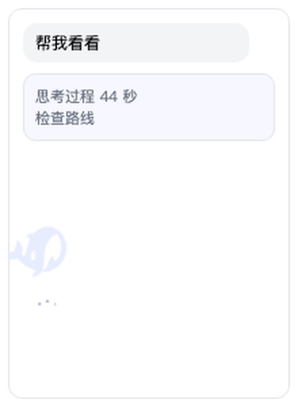

# FatFish

**A chubby whale that hops from chat bubble to chat bubble.**

FatFish is a single-file, zero-dependency web widget: one `<script>`, one custom element. Drop it into any container that already looks like a conversation and it hops between the rows — tail wagging, leaping from the top of one bubble to the next, splashing a few droplets on landing.

The arc height follows the horizontal distance of each hop, so short hops stay low and long hops rise; nothing is hard-coded to one row. Point it at your own coordinates and it hops wherever you like.



## Quick start

```html
<script src="fatfish.js"></script>

<div class="chat" style="position:relative; height:420px">
  <!-- your messages -->
  <fatfish></fatfish>
</div>
```

`<fatfish>` fills its parent, clips to it, and sets `pointer-events:none` so it never eats a click. If the parent is not positioned, `position:relative` is added for you and restored on removal.

Without a route it picks its own spot near the bottom of the container and hops along the waterline.

## Routes

A route is a list of **legs**; each leg is one hop, played in order and looping. A leg only says where it takes off and where it lands:

```js
const fish = document.querySelector('fatfish')

fish.routeFor = (host, size) => [
  { from: { x: 60,  y: 300 }, to: { x: 240, y: 140 } },
  { from: { x: 240, y: 140 }, to: { x: 420, y: 300 } },
]
```

- `from` / `to` are in the parent's coordinate system, in pixels.
- `lift` is optional: override the computed arc height for that leg.
- The whale faces its travel direction automatically, so you only give points.
- `routeFor` is re-read on resize and after every leg; return the same array to keep the rhythm, or a new one to change where it goes next.

To follow a chat, compute the anchor of each row at call time — the last message bubble, the thinking block, the reply — and build legs between their top edges. FatFish does not know your DOM; that mapping stays yours.

## Attributes

| Attribute | Default | Meaning |
| --- | --- | --- |
| `size` | `56` | Edge length in px |
| `ink` | `.13` | Opacity in light mode |
| `ink-dark` | `.2` | Opacity in dark mode (`prefers-color-scheme`) |
| `color` | `#4D6BFE` | Fill color |
| `duration` | `3.6s` | Time for one hop |

## Motion details

- One hop is a single CSS keyframe track; the landing splash is eight small circles on the same clock, so no JavaScript runs per frame.
- With `prefers-reduced-motion: reduce` the whale sits still and no droplets appear.
- No images, no fonts, no network requests. The mark is inline SVG.

## Files

- `fatfish.js` — the widget (the only file you need)
- `index.html` — a demo page
- `demo-route.gif`, `demo.png`, `demo-route.png` — previews

## Browser support

Any browser with custom elements and CSS custom properties: Chrome/Edge 67+, Safari 12.1+, Firefox 63+.

## License

MIT
